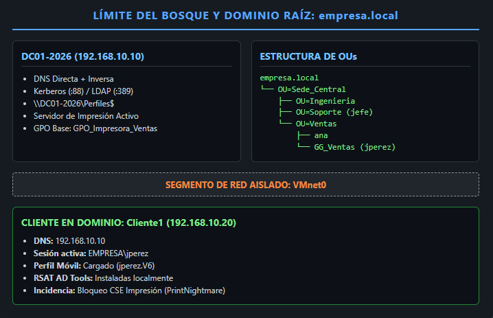
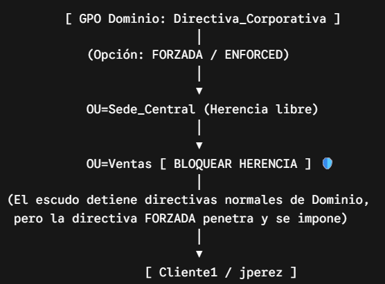
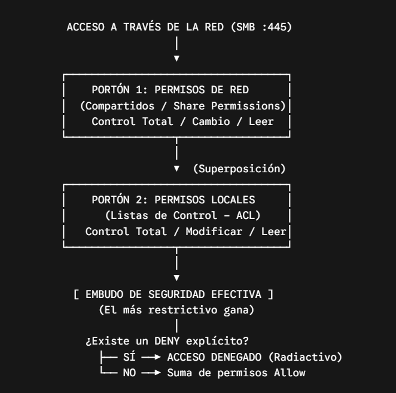
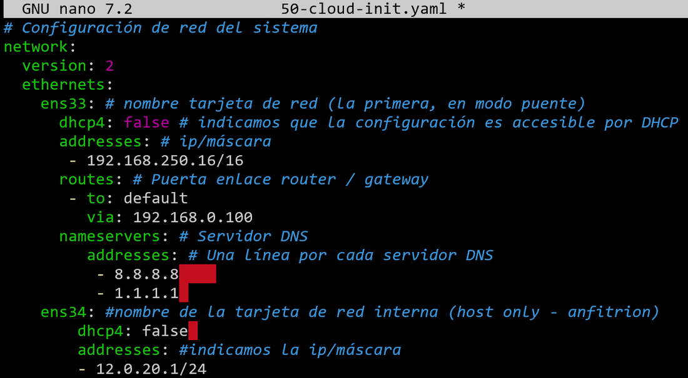
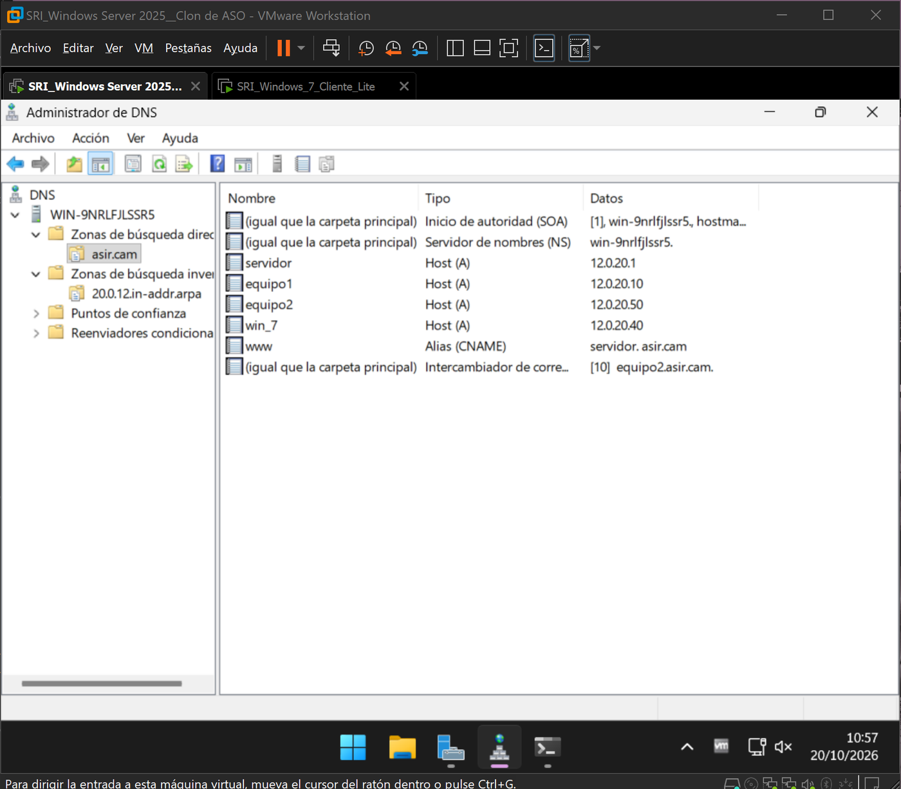
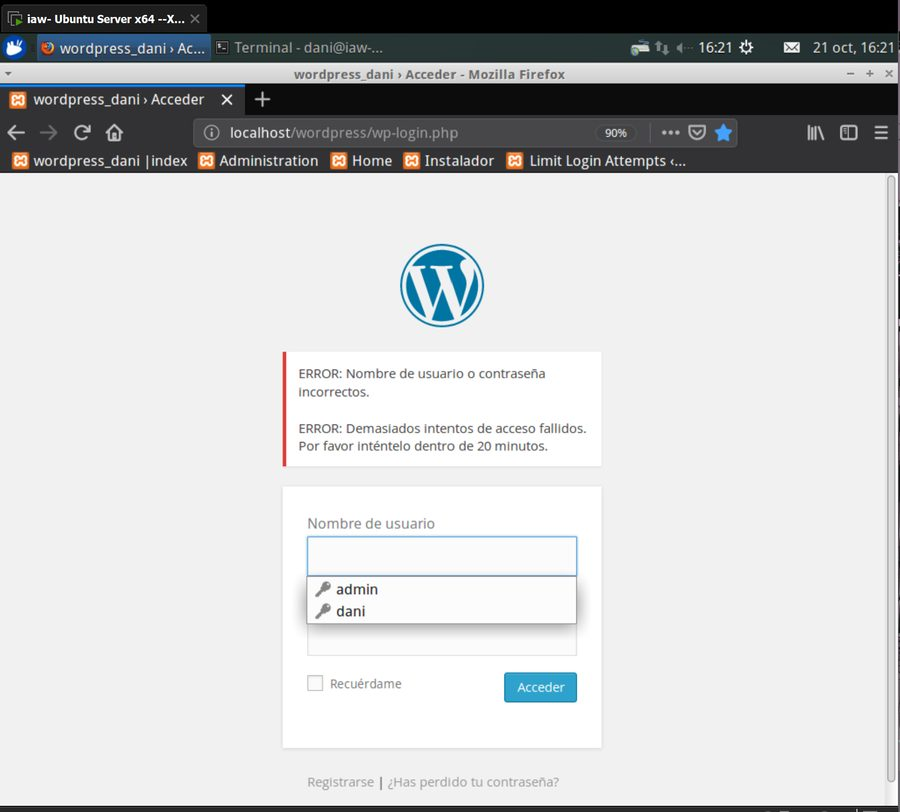

# Proyectos del CFGS ASIR

Prácticas del ciclo de **Administración de Sistemas Informáticos en Red** (Liceo La Paz, A Coruña). Todo se monta en **máquinas virtuales** (VMware Workstation) y se documenta paso a paso: objetivo, pasos, capturas y una **prueba final** que demuestra que funciona. Los apuntes completos están publicados en mi web: [daniroca5.gamer.gd](https://daniroca5.gamer.gd/).

## 2.º curso

### Sistemas operativos: dominio Active Directory (ASO)

Un proyecto por fases sobre **Windows Server 2025**, con clientes **Windows 11**, en una red aislada:

1. **Controlador de dominio**: AD DS, DNS integrado (zonas directa e inversa) y un bosque nuevo `empresa.local`. Administración remota por **SSH** y con **RSAT** desde el cliente.
2. **Identidad**: unidades organizativas por sede y departamento, usuarios y grupos, unión del cliente al dominio y **perfiles móviles** guardados en el servidor. Diagnóstico de **Kerberos y LDAP** cuando algo no autentica.
3. **Gobernanza con GPO**: directivas de dominio y de unidad organizativa, **bloqueo de herencia frente a directiva forzada** y comprobación con `gpresult`. También resolví una incidencia real: la impresión bloqueada por las protecciones de *PrintNightmare*.
4. **Acceso a recursos**: carpetas compartidas con permisos de **recurso compartido + NTFS**. Es la «doble puerta»: gana el permiso más restrictivo, y un *Deny* explícito manda sobre todo.

 

### Servicios de red: DHCP y DNS (SRI)

- **DHCP en Windows Server y en Ubuntu Server** (`isc-dhcp-server`):
  - ámbitos con exclusiones, puerta de enlace y servidores DNS;
  - **reserva de una IP para la MAC** de un cliente concreto;
  - la red interna configurada con **netplan**.

  Se comprueba desde un cliente Windows 7 con `ipconfig /all` y renovando la concesión.
- **DNS en Windows Server**:
  - zonas de búsqueda **directa e inversa**;
  - registros **A**, **CNAME** y **MX**;
  - sufijos DNS y **reenviadores** para salir a Internet.

  Se comprueba con `nslookup` desde el cliente.

 

### Aplicaciones web (IAW)

- **Entorno**: servidor web **LAMP** y **XAMPP**, servidor **FTP** y correo.
- **CMS**: instalación y configuración de **WordPress** (entradas, menús, comentarios, lectura) y de **Joomla**.
- **Seguridad del blog**, paso a paso:
  - copia de la base de datos y de los ficheros;
  - borrar lo que revela la versión;
  - `.htaccess` sin listado de carpetas;
  - **límite de intentos de acceso** con un plugin;
  - mover `wp-config.php` fuera de la raíz.
- **Publicación** del blog en un alojamiento gratuito: crear la base de datos, importarla, cambiar las URL con SQL y subir los ficheros por FTP.

### Bases de datos (ASXBD)

**MySQL** en Linux y Windows:
- **copias de seguridad** con `mysqldump` (todas las bases, bases sueltas, tablas, rutinas, excluyendo tablas) y con nombre fechado;
- restauración y exportación con `SELECT … INTO OUTFILE` y Workbench;
- **usuarios** (origen, contraseñas que caducan, `ALTER USER`) y **privilegios**;
- **rutinas almacenadas**.

### Seguridad (SAD) y criptografía (ACP)

- **SAD**:
  - principios (CIDAN, defensa en profundidad), amenazas físicas y lógicas;
  - **tipos de ataque** (reconocimiento, DoS, MITM) y de **malware**;
  - fases del **análisis forense** y planes y políticas de seguridad (familia ISO 27000).
- **ACP**: correo **cifrado y firmado con OpenPGP** en Thunderbird, intercambio de claves y uso del **certificado electrónico**.

## 1.er curso

| Módulo | Qué se hizo |
|---|---|
| **ISO** | Scripting en **Bash** y tareas con **cron** ([automatizacion-bash](https://github.com/daniroca5/automatizacion-bash)), **PowerShell**, dominios y contenedores **Docker** |
| **PAR** | Redes en **Packet Tracer**: subredes, **VLAN** y enrutamiento estático y dinámico |
| **LM** | **XML** con DTD y XSD, **JSON y YAML**, y un portfolio en HTML y CSS ([FlexboxRocaDaniel](https://github.com/daniroca5/FlexboxRocaDaniel)) |
| **BDD** | Modelo **entidad-relación** y **SQL** |
| **FHW** | **Git**, Python e **IoT** |

## Cómo documento

Cada práctica es un documento Markdown con pasos marcables y una prueba por hito: un `gpresult`, un `nslookup`, un acceso denegado… Del mismo documento salen la página de la web y el **PDF de entrega** (ver [proyectos-con-ia](https://github.com/daniroca5/proyectos-con-ia)).

---
Daniel Roca Martínez · [Currículum](https://daniroca5.gamer.gd/cv/)
